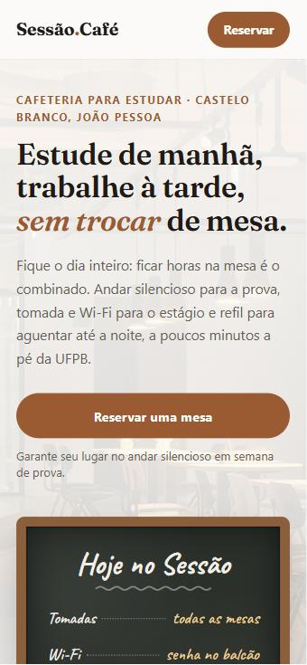

# Relatório: nova primeira dobra do Sessão.Café

Reescrevi a primeira dobra seguindo a regra de Copy "escreva para uma pessoa, não para um mercado". A pessoa que eu criei é a Malu: ela faz Ciência da Computação na UFPB, está no 4º período, em semana de prova, e já estagia. Ou seja, ela passa o dia inteiro sentada. Precisa de silêncio para estudar Estrutura de Dados, de tomada e Wi-Fi bom para deixar o Claude revisando os PRs do time e de combustível para aguentar até a noite.

## 1. Como ficou

*Print no celular (375px). No desktop, o texto fica à esquerda e o quadro "Hoje no Sessão" fica à direita.*

## 2. Bloco a bloco

**Linha de cima: "Cafeteria para estudar · Castelo Branco, João Pessoa"**
Responde: *"Que lugar é esse, e fica perto de mim?"*
Tirei o "e trabalhar" para afunilar o público para universitários. Coloquei o bairro para deixar claro, logo de cara, que o café fica do lado da UFPB. No começo eu tinha escrito Cabo Branco, mas a UFPB fica em Castelo Branco. Cabo Branco é na praia e passaria a ideia de que é longe.

**Título: "Estude de manhã, trabalhe à tarde, *sem trocar* de mesa."**
Responde: *"Por que aqui e não em qualquer outro café de estudo?"*
O título antigo ("O café onde você foca de verdade") servia para qualquer study café. Esse novo descreve o dia da Malu: prova de manhã, estágio à tarde, tudo no mesmo lugar. O destaque em "sem trocar" mostra o que a gente tem de diferente, que é poder passar o dia inteiro aqui.

**Linha de baixo: "Fique o dia inteiro: ficar horas na mesa é o combinado. Andar silencioso para a prova, tomada e Wi-Fi para o estágio e refil para aguentar até a noite, a poucos minutos a pé da UFPB."**
Responde: *"Posso mesmo ficar o dia todo? Tem o que eu preciso?"*
Primeiro dou a permissão para ficar, porque em café comum a pessoa sente que está atrapalhando. Depois liguei cada coisa a uma necessidade dela: silêncio para a prova, tomada e Wi-Fi para o estágio e refil como combustível. No fim, repito que fica perto da UFPB.

**Botão: "Reservar uma mesa"**
Responde: *"Beleza, e agora, o que eu faço?"*
É o único passo que eu quero que ela dê. Embaixo do botão (ao lado, no desktop) tem uma nota curta: "Garante seu lugar no andar silencioso em semana de prova." Ela responde à dúvida "por que reservar, se não é obrigatório?", e o argumento vem do próprio FAQ do site.

## 3. A ação única

A ação única é **reservar uma mesa**.

Antes, o hero tinha dois botões: "Reservar uma mesa" e "Ver o cardápio". O cardápio puxava a atenção para outro lado e dividia a decisão da Malu, então tirei esse botão do hero. O cardápio continua na página, mais abaixo, e no menu do topo.

Para não ficar um buraco onde estava o segundo botão:
- **No celular,** o botão agora ocupa a largura toda e a nota vem logo embaixo.
- **No desktop,** a nota fica ao lado do botão, no espaço que o "Ver o cardápio" ocupava.

O botão "Reservar" no topo da página leva para o mesmo lugar, então ele reforça a ação em vez de concorrer com ela.

Também atualizei a descrição que aparece no Google e quando o link é compartilhado. Ela agora fala de Castelo Branco e da UFPB, em vez de "universitários e profissionais".
